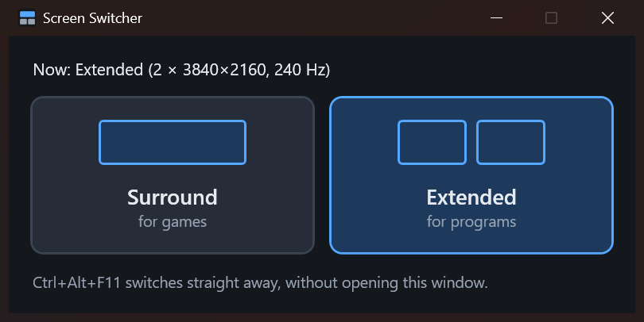

# Screen Switcher

Turns NVIDIA Surround on and off with one click: Surround joins the monitors into one wide screen for games, Extended gives each monitor back as its own screen for everything else.



Switching takes about 4 seconds. The program remembers both layouts as they were last seen on the screens (resolution, refresh rate, monitor order) and puts them back exactly.

## Download

Get `ScreenSwitcher.exe` from the [latest release](https://github.com/gregmol123/nvidia-surround-switcher/releases/latest) and put it in a folder of its own, because it keeps its settings in `screens.json` next to the exe. The exe is not signed, so Windows may warn about an unknown publisher the first time: choose **More info**, then **Run anyway**.

## Requirements

- Windows 10 or 11, 64-bit
- An NVIDIA graphics card and driver that can turn on Surround in the NVIDIA Control Panel
- [.NET Desktop Runtime 9](https://dotnet.microsoft.com/download/dotnet/9.0) or newer

AMD and Intel cards are not supported: the program talks to the NVIDIA driver through NVAPI.

Tested on a GeForce RTX 5090 (driver 621.01) with two 4K 240 Hz monitors. Other NVIDIA cards that support Surround should work but have not been tried. Several cards in SLI may need a driver reload to switch, which the program does not allow.

## First run

1. Turn Surround on once in the NVIDIA Control Panel, set up the way you want it for games.
2. Open `ScreenSwitcher.exe`. It saves that layout to `screens.json` next to the exe.

From then on it switches both ways. If you later change Surround in the NVIDIA Control Panel, the program picks up the new layout the next time it runs while Surround is on.

If the monitors are moved to other ports or the card is replaced, delete `screens.json` and do the first run again.

## Use

- Open `ScreenSwitcher.exe` and click **Surround** or **Extended**. The window closes once the screens have switched.
- From a shortcut, a script or a launcher such as LaunchBox:

  ```
  ScreenSwitcher.exe surround
  ScreenSwitcher.exe extended
  ScreenSwitcher.exe toggle
  ```

- For the keyboard shortcut the window mentions, make a Windows shortcut to `ScreenSwitcher.exe toggle` in the Start menu or on the desktop, and set its **Shortcut key** to Ctrl+Alt+F11 in the shortcut's Properties.

## Build

```
dotnet publish src/ScreenSwitcher.csproj -c Release -o .
```

Needs the .NET 9 SDK. The result is a single `ScreenSwitcher.exe`.
